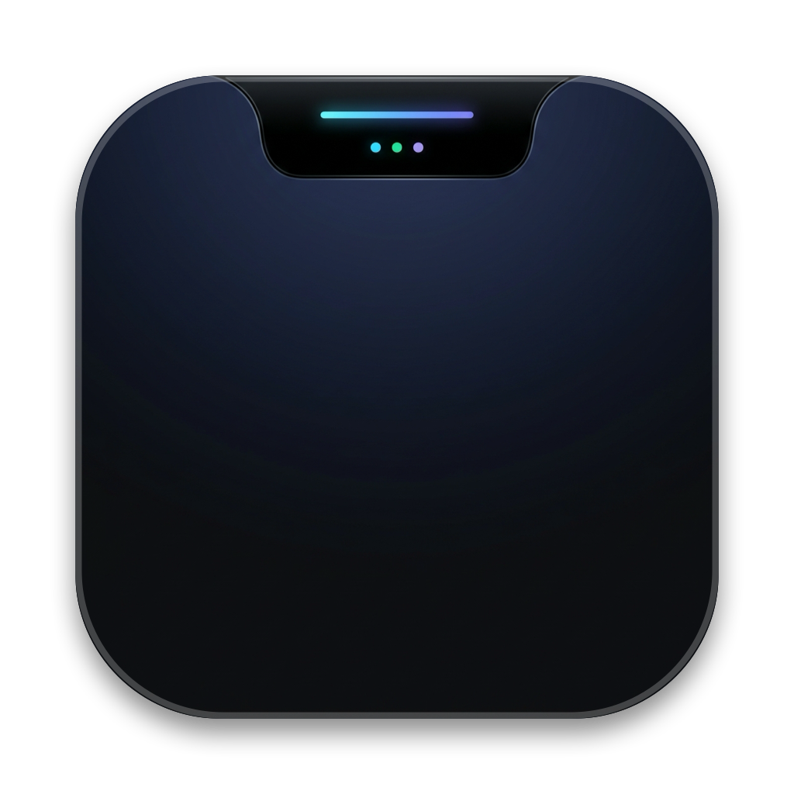
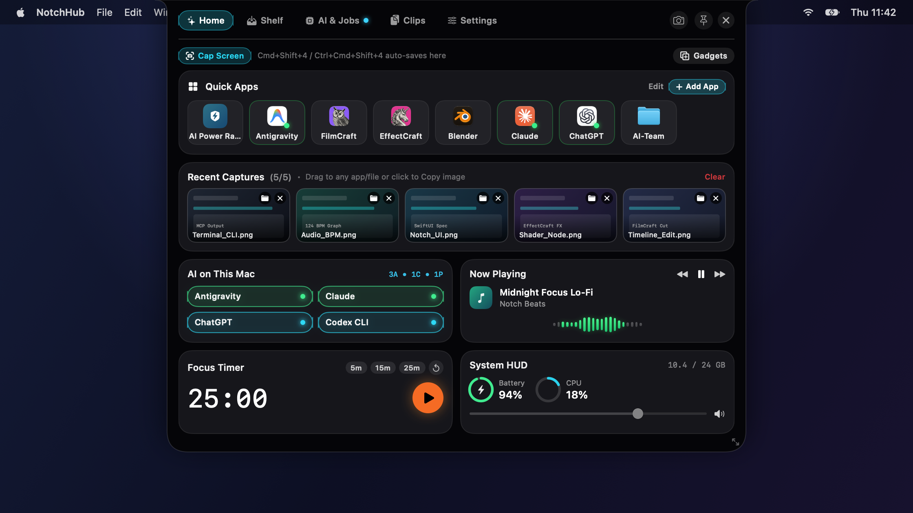
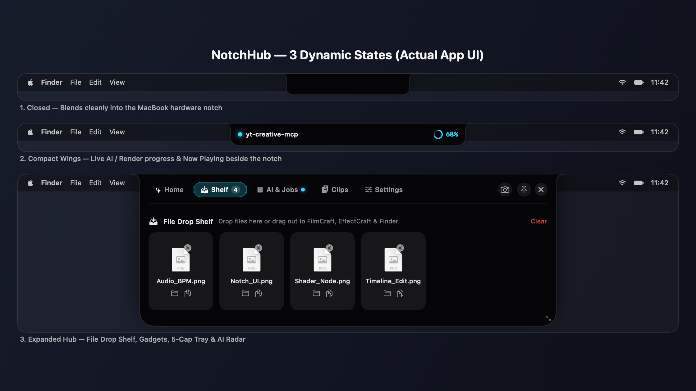
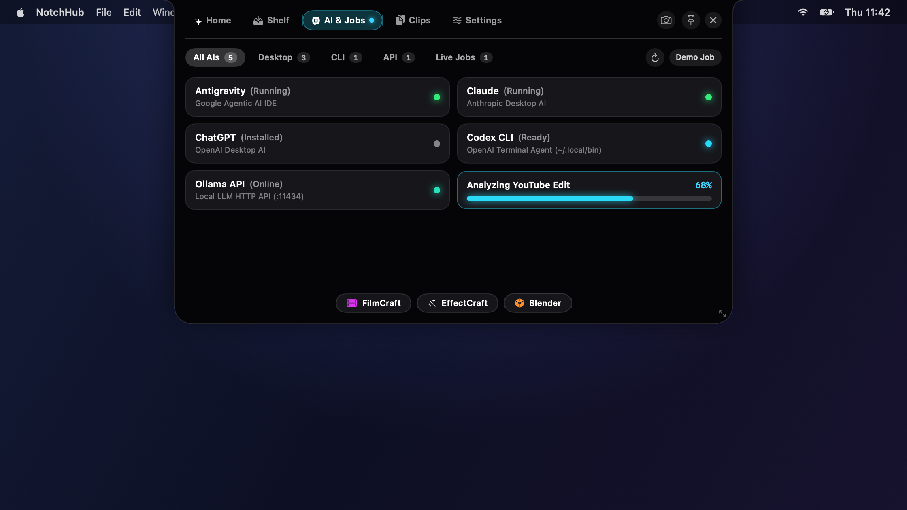
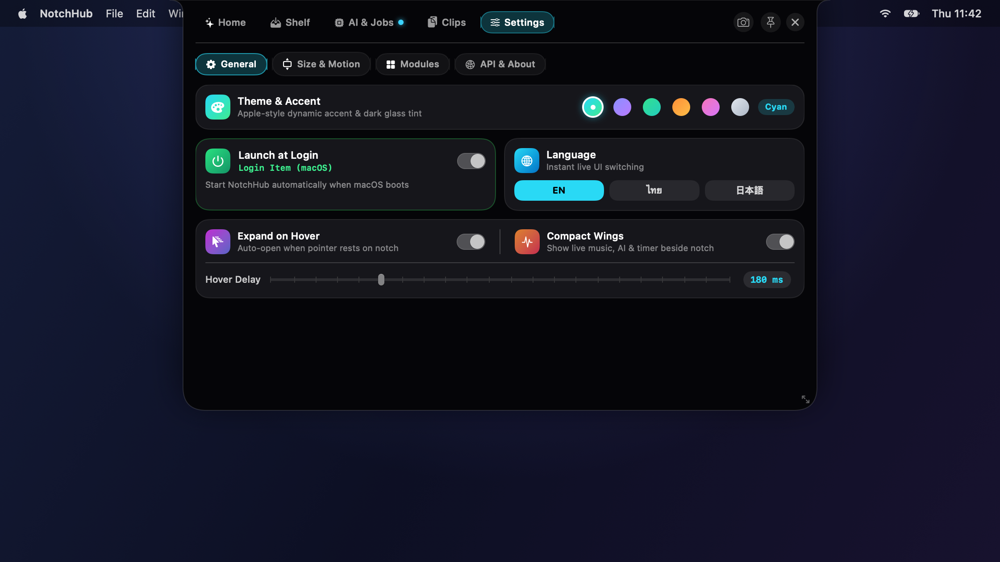

<p align="center">
  <a href="./README.md">English</a> &nbsp;|&nbsp;
  <a href="./README.th.md">ภาษาไทย</a> &nbsp;|&nbsp;
  <strong>日本語</strong>
</p>

<p align="center">
  
</p>

<h1 align="center">NotchHub</h1>

<p align="center">
  <strong>ネイティブ macOS ダイナミックアイランド — カスタムガジェット・スクショ5枚トレイ・ファイルシェルフ・AI レーダー</strong><br/>
  Swift / SwiftUI / AppKit (<code>NSPanel</code>) 製 • macOS 14+ (Apple Silicon) 対応 • 超軽量 (~1 MB)
</p>

<p align="center">
  <a href="https://github.com/panusbodee-owen/notch-hub/releases/latest/download/NotchHub-macOS-arm64.dmg"><strong>.dmg をダウンロード (インストーラー)</strong></a> &nbsp;•&nbsp;
  <a href="https://github.com/panusbodee-owen/notch-hub/releases/latest/download/NotchHub-macOS-arm64.zip"><strong>.zip をダウンロード (直接解凍)</strong></a> &nbsp;•&nbsp;
  <a href="https://github.com/panusbodee-owen/notch-hub/releases/latest"><strong>リリース一覧</strong></a>
</p>

<p align="center">
  
</p>

---

## ダイレクトダウンロード & 1行インストール

- **macOS インストーラー (`.dmg` — Applications へドラッグ):**  
  https://github.com/panusbodee-owen/notch-hub/releases/latest/download/NotchHub-macOS-arm64.dmg
- **macOS アーカイブ (`.zip` — 解凍してすぐ起動):**  
  https://github.com/panusbodee-owen/notch-hub/releases/latest/download/NotchHub-macOS-arm64.zip

### ターミナルから1行でインストール
```bash
curl -fL "https://github.com/panusbodee-owen/notch-hub/releases/latest/download/NotchHub-macOS-arm64.zip" -o /tmp/NotchHub.zip && ditto -xk /tmp/NotchHub.zip /Applications && xattr -dr com.apple.quarantine /Applications/NotchHub.app && open /Applications/NotchHub.app
```

> **初回起動時の注意 (macOS Gatekeeper):** ブラウザからダウンロードした場合、未公証ビルドのため警告が表示されることがあります。その場合は1度だけ以下を実行してください:
> ```bash
> xattr -dr com.apple.quarantine /Applications/NotchHub.app
> ```

---

## 機能ビジュアル

### 3段階ダイナミックノッチ & ドラッグ＆ドロップ連携
<p align="center">
  
</p>

### AI レーダー & ライブジョブ (デスクトップアプリ • CLI • API)
<p align="center">
  
</p>

### モダン設定画面 (ログイン時自動起動 • 3言語切替 • サイズ＆モジュール)
<p align="center">
  
</p>

---

## 主な機能

- **3状態ダイナミックノッチ & 自由なリサイズ:**
  - `Closed`（ノッチに自然に同化）/ `Compact Wings`（左右にミニステータス表示）/ `Expanded`（フルスクリーン上でもフォーカスを奪わず展開）
  - 右下コーナー（`↖↘`）をドラッグしてリアルタイムに幅・高さを調整可能。設定タブから **`S / M / L / XL`** プリセットやスライダーでも細かく調整できます。
  - **アプリ内 3言語切り替え対応:** 設定画面から **`EN` / `ไทย` / `日本語`** をワンクリックで切り替え可能。
- **クイックアプリ & ワンクリック追加 (`+ アプリ追加`):**
  - よく使う macOS アプリ（`.app`）、プロジェクトフォルダ、ローカル Web アプリ（`http://localhost:PORT`）、ターミナル起動コマンドをノッチにピン留めして即起動（起動中アプリは緑ドット表示）。
  - Finder 選択、URL/コマンド入力、または `.app`/フォルダのドラッグ＆ドロップで簡単に追加できます。
- **カスタマイズ可能なホームガジェット:**
  - ホーム画面の **`ガジェット`** ボタンから、**スクショ (5)**、**AI レーダー**、**メディア**、**AI ジョブ**、**タイマー**、**システム HUD**、**クイックメモ**、**時計** を自由に追加・削除・並べ替えできます。
- **最新5枚のスクリーンショット自動トレイ:**
  - `Cmd+Shift+3/4/5`（ファイル保存）、`Ctrl+Cmd+Shift+3/4`（クリップボード保存）、またはノッチ上の **`スクショ`** ボタンから最新5枚を自動収集。
  - サムネイルを **FilmCraft / EffectCraft / Figma / Finder / Slack / ブラウザ** へそのままドラッグ＆ドロップ、またはワンクリックで画像をコピーして即 `Cmd+V` できます。
- **AI レーダー (Desktop App • CLI • API 自動検出):**
  - この Mac 上の AI **デスクトップアプリ**（Antigravity, Claude, ChatGPT, Cursor, Ollama 等）、**CLI**（`agy`, `codex`, `claude`, `gemini`, `ollama`, MCP サーバー）、**ローカル/クラウド API**（ポート監視＋シークレット値を読まずにキー設定のみ安全検出）を一覧表示し、ワンクリックで起動・実行できます。
- **ファイルシェルフ・クリップボード履歴・カメラミラー:**
  - 画面上部中央へファイルをドラッグするとシェルフが自動展開。ピン留め可能なクリップボード履歴や、会議前のワンクリック・カメラミラーも搭載。

---

## ローカル HTTP API で AI / レンダー進捗を送信

ループバック限定（`http://127.0.0.1:47890`）の API に POST するだけで、AI エージェントや動画レンダリングの進捗バーをノッチに表示できます:

```bash
./scripts/notch-notify.sh yt-1 "yt-creative-mcp" running "Analyzing YouTube Edit" "Detecting cuts & 124 BPM" 0.68
```

```bash
curl -X POST http://127.0.0.1:47890/v1/activity \
  -H 'Content-Type: application/json' \
  -d '{"id":"fc-render","source":"FilmCraft","state":"running","title":"Rendering Timeline","detail":"1080p60 H.264","progress":0.42}'
```

---

## ソースからビルド (macOS 14+ / Apple Silicon)

```bash
git clone https://github.com/panusbodee-owen/notch-hub.git
cd notch-hub
swift run NotchHubSelfTest
./scripts/package_release.sh
open dist/NotchHub.app
```

## ライセンス

MIT — 詳細は [LICENSE](./LICENSE) をご覧ください。
