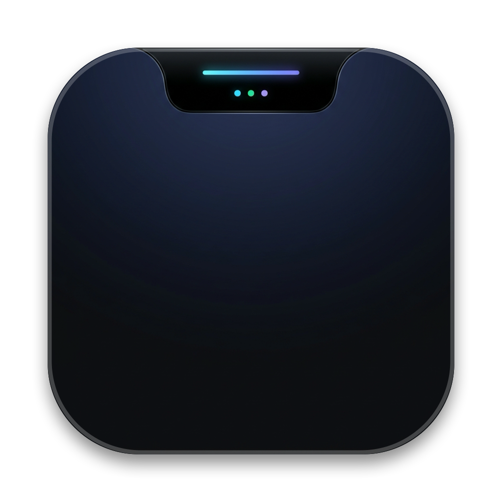
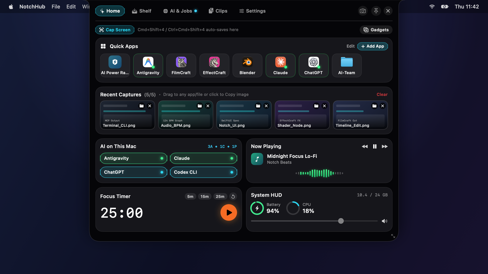
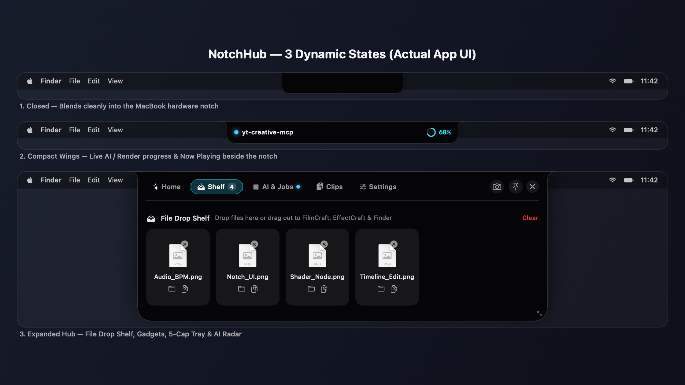
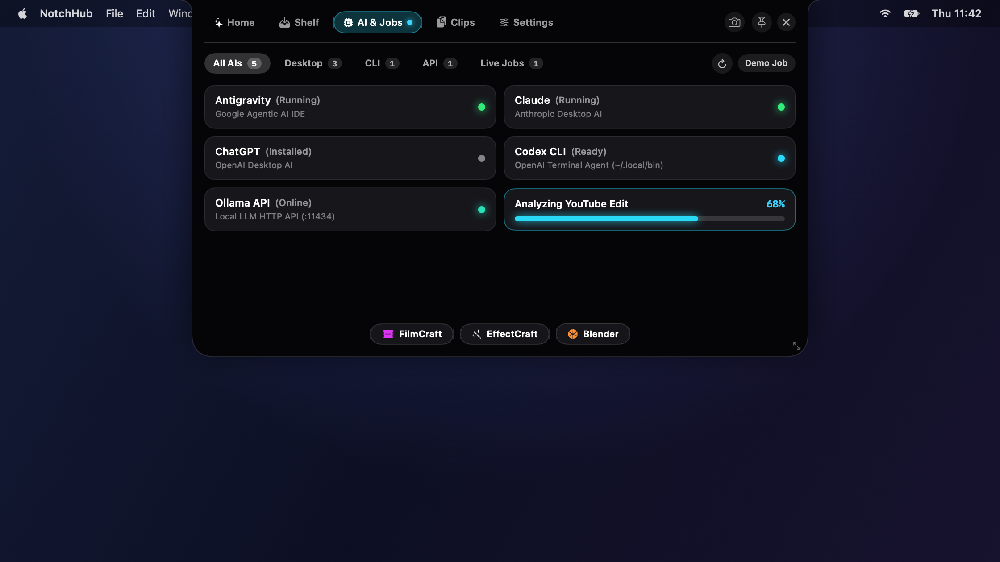
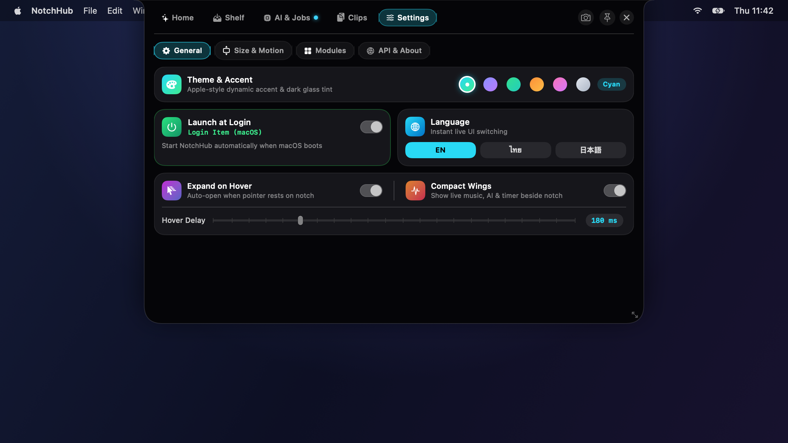

<p align="center">
  <strong>English</strong> &nbsp;|&nbsp;
  <a href="./README.th.md">ภาษาไทย</a> &nbsp;|&nbsp;
  <a href="./README.ja.md">日本語</a>
</p>

<p align="center">
  
</p>

<h1 align="center">NotchHub</h1>

<p align="center">
  <strong>Native macOS Dynamic Island — Modular Gadgets, 5-Slot Screenshot Tray, File Drop Shelf &amp; AI Radar</strong><br/>
  Built with pure Swift, SwiftUI &amp; AppKit (<code>NSPanel</code>) for macOS 14+ (Apple Silicon) • ~1 MB download • Ultra-lightweight
</p>

<p align="center">
  <a href="https://github.com/panusbodee-owen/notch-hub/releases/latest/download/NotchHub-macOS-arm64.dmg"><strong>Download .dmg (macOS Installer)</strong></a> &nbsp;•&nbsp;
  <a href="https://github.com/panusbodee-owen/notch-hub/releases/latest/download/NotchHub-macOS-arm64.zip"><strong>Download .zip (Direct Archive)</strong></a> &nbsp;•&nbsp;
  <a href="https://github.com/panusbodee-owen/notch-hub/releases/latest"><strong>All Releases</strong></a>
</p>

<p align="center">
  
</p>

---

## Direct Download & 1-Line Install

- **macOS Installer (`.dmg` — drag into Applications):**  
  https://github.com/panusbodee-owen/notch-hub/releases/latest/download/NotchHub-macOS-arm64.dmg
- **macOS Archive (`.zip` — unzip and launch):**  
  https://github.com/panusbodee-owen/notch-hub/releases/latest/download/NotchHub-macOS-arm64.zip

### One-Line Terminal Install
```bash
curl -fL "https://github.com/panusbodee-owen/notch-hub/releases/latest/download/NotchHub-macOS-arm64.zip" -o /tmp/NotchHub.zip && ditto -xk /tmp/NotchHub.zip /Applications && xattr -dr com.apple.quarantine /Applications/NotchHub.app && open /Applications/NotchHub.app
```

> **First-launch note (macOS Gatekeeper):** Because builds are ad-hoc signed without paid Apple Developer notarization, if macOS shows a warning after downloading via browser, run once:
> ```bash
> xattr -dr com.apple.quarantine /Applications/NotchHub.app
> ```

---

## Visual Overview

### 3-State Dynamic Notch & Drag-and-Drop Workflow
<p align="center">
  
</p>

### AI Radar & Live Jobs Hub (Desktop Apps • CLI • Local & Cloud APIs)
<p align="center">
  
</p>

### Polished Settings (Launch at Login • 3 Languages • Size Presets • Modules)
<p align="center">
  
</p>

---

## Key Features

- **3-State Dynamic Notch + Live Resizing:**
  - Seamlessly blends into the MacBook hardware notch (`Closed`), shows subtle status wings (`Compact`), and expands smoothly on hover/click (`Expanded`) over full-screen apps without stealing focus.
  - **Adjustable size:** Drag the bottom-right corner (`↖↘`) symmetrically in real time, pick **`S / M / L / XL`** presets, or fine-tune width, height, and compact wing width in **Settings**.
  - **Built-in 3-Language UI:** Switch instantly between **`EN` / `ไทย` / `日本語`** inside Settings.
- **Quick Apps Dock & 1-Click Add App:**
  - Pin your most-used macOS `.app` bundles, project folders, local web apps (`http://localhost:PORT`), or Terminal launch commands directly in the Notch.
  - Add new items via native Finder picker (**`Pick .app / Folder...`**), inline URL/Command form, or drag-and-drop any `.app`/folder straight onto the bar — with live green running indicators.
- **Customizable Home Gadgets:**
  - Click **`Gadgets`** on the Home tab to add, remove, or reorder: **Recent Captures (5)**, **My AIs Radar**, **Media**, **AI Jobs**, **Timer**, **System HUD**, **Quick Note**, and **Clock**.
- **Auto 5-Slot Screenshot Tray:**
  - Automatically captures your latest 5 screenshots from `Cmd+Shift+3/4/5` (saved to disk), `Ctrl+Cmd+Shift+3/4` (copied to clipboard), or the 1-click **`Cap Screen`** button.
  - Drag thumbnails directly into **FilmCraft, EffectCraft, Figma, Finder, Slack, Docs, or Browsers**, or click once to copy the image for instant `Cmd+V`.
- **AI Radar (Desktop Apps • CLI • APIs):**
  - Automatically scans this Mac for AI **Desktop Apps** (Antigravity, Claude, ChatGPT, Cursor, Ollama, LM Studio, etc.), **CLIs** (`agy`, `codex`, `claude`, `gemini`, `ollama`, MCP servers), and **Local/Cloud APIs** (ports + safely checking key presence without reading secret values) with 1-click Open / Run / Copy.
- **File Drop Shelf, Clipboard History & Camera Mirror:**
  - Drag any file to the top-center of your screen to auto-open the File Drop Shelf; keep pinned clipboard/prompt snippets; check your camera/lighting in 1 click.

---

## Push Live AI / Render Progress via Local HTTP API

NotchHub listens strictly on loopback (`http://127.0.0.1:47890`) so AI agents, MCP servers, or render scripts can stream live progress straight into your Notch:

```bash
./scripts/notch-notify.sh yt-1 "yt-creative-mcp" running "Analyzing YouTube Edit" "Detecting cuts & 124 BPM" 0.68
```

```bash
curl -X POST http://127.0.0.1:47890/v1/activity \
  -H 'Content-Type: application/json' \
  -d '{"id":"fc-render","source":"FilmCraft","state":"running","title":"Rendering Timeline","detail":"1080p60 H.264","progress":0.42}'
```

---

## Build From Source (macOS 14+ / Apple Silicon)

```bash
git clone https://github.com/panusbodee-owen/notch-hub.git
cd notch-hub
swift run NotchHubSelfTest
./scripts/package_release.sh
open dist/NotchHub.app
```

## License

MIT — see [LICENSE](./LICENSE).
