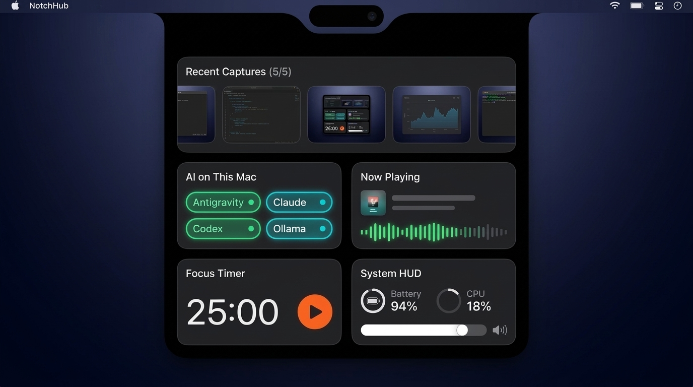
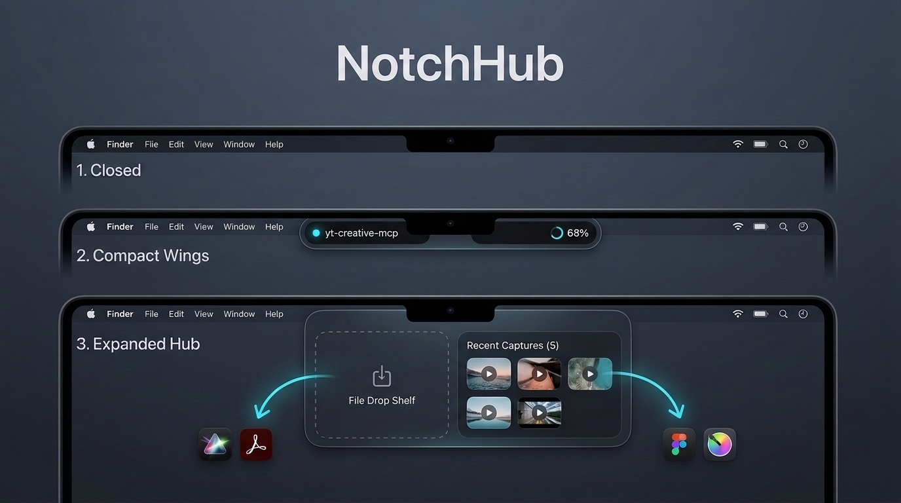
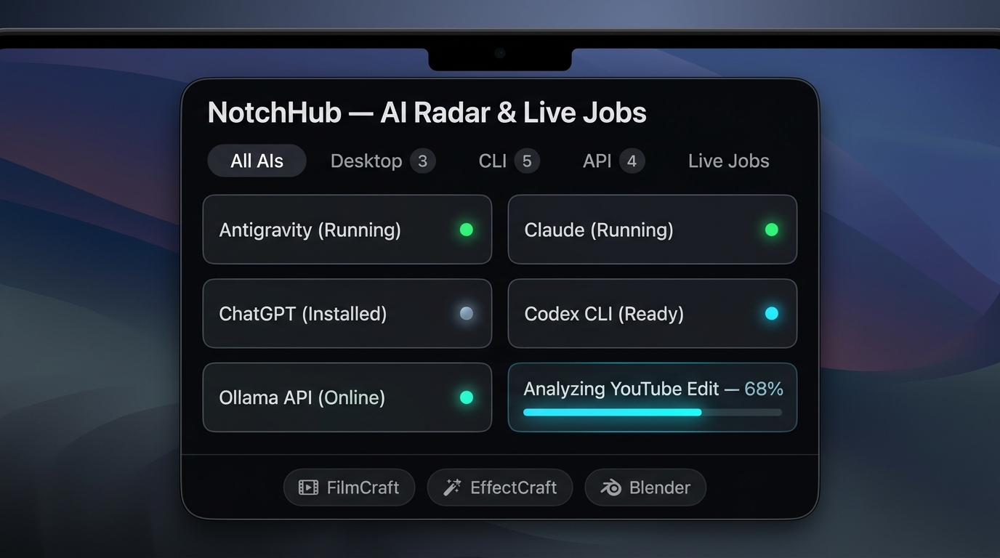

<p align="center">
  <a href="./README.md">English</a> &nbsp;|&nbsp;
  <strong>ภาษาไทย</strong> &nbsp;|&nbsp;
  <a href="./README.ja.md">日本語</a>
</p>

<h1 align="center">NotchHub</h1>

<p align="center">
  <strong>Dynamic Island แบบ Native สำหรับ macOS — รวม Gadget, ถาดเก็บรูป Cap 5 รูป, ถาดพักไฟล์ และ AI Radar</strong><br/>
  พัฒนาด้วย Swift + SwiftUI + AppKit (<code>NSPanel</code>) สำหรับ macOS 14+ (Apple Silicon) • เบา ลื่น ขนาดไฟล์ ~1 MB
</p>

<p align="center">
  <a href="https://github.com/panusbodee-owen/notch-hub/releases/latest/download/NotchHub-macOS-arm64.dmg"><strong>ดาวน์โหลด .dmg (ตัวติดตั้ง macOS)</strong></a> &nbsp;•&nbsp;
  <a href="https://github.com/panusbodee-owen/notch-hub/releases/latest/download/NotchHub-macOS-arm64.zip"><strong>ดาวน์โหลด .zip (แตกไฟล์ใช้ทันที)</strong></a> &nbsp;•&nbsp;
  <a href="https://github.com/panusbodee-owen/notch-hub/releases/latest"><strong>ดู Releases ทั้งหมด</strong></a>
</p>

<p align="center">
  
</p>

---

## ดาวน์โหลดตรงๆ & ติดตั้งแบบ 1 บรรทัด

- **ไฟล์ `.dmg` (เปิดแล้วลากเข้า Applications ได้เลย):**  
  https://github.com/panusbodee-owen/notch-hub/releases/latest/download/NotchHub-macOS-arm64.dmg
- **ไฟล์ `.zip` (แตกไฟล์แล้วเปิดใช้งานได้ทันที):**  
  https://github.com/panusbodee-owen/notch-hub/releases/latest/download/NotchHub-macOS-arm64.zip

### ติดตั้งผ่าน Terminal ในคำสั่งเดียว
```bash
curl -fL "https://github.com/panusbodee-owen/notch-hub/releases/latest/download/NotchHub-macOS-arm64.zip" -o /tmp/NotchHub.zip && ditto -xk /tmp/NotchHub.zip /Applications && xattr -dr com.apple.quarantine /Applications/NotchHub.app && open /Applications/NotchHub.app
```

> **หมายเหตุครั้งแรกที่เปิดแอป (macOS Gatekeeper):** เนื่องจากแอปใช้ ad-hoc sign ยังไม่ได้ Notarize ผ่าน Apple Developer หากโหลดจากเบราว์เซอร์แล้ว macOS แจ้งเตือน ให้รันคำสั่งนี้ 1 ครั้งแล้วเปิดใหม่:
> ```bash
> xattr -dr com.apple.quarantine /Applications/NotchHub.app
> ```

---

## ภาพตัวอย่างการทำงาน

### Dynamic Notch 3 สถานะ + ลากพักไฟล์และรูป Cap
<p align="center">
  
</p>

### AI Radar & Live Jobs (สแกน Desktop App • CLI • API ทั้งเครื่อง)
<p align="center">
  
</p>

---

## ฟีเจอร์เด่นทั้งหมด

- **Dynamic Notch 3 สถานะ + ปรับขนาดได้อิสระ:**
  - `Closed` (เนียนกลืนไปกับรอยบาก) / `Compact Wings` (โชว์สถานะข้างรอยบาก) / `Expanded` (กางออกเหนือ Full-Screen โดยไม่แย่ง Focus)
  - ลากมุมขวาล่าง (`↖↘`) ปรับขนาดกว้าง-สูงได้สดๆ หรือเลือก Preset **`S / M / L / XL`** + สไลเดอร์ในแท็บ **ตั้งค่า (Settings)**
  - **รองรับ 3 ภาษาในตัวแอป:** สลับ **`EN` / `ไทย` / `日本語`** ได้ทันทีในแท็บ Settings
- **หน้า Home ปรับแต่ง Gadget เองได้:**
  - กดปุ่ม **`Gadgets`** เพื่อเพิ่ม/ลบ/สลับตำแหน่ง: **ภาพ Cap (5)**, **AI ในเครื่อง**, **เพลง**, **สถานะงาน AI**, **จับเวลา**, **สถานะเครื่อง**, **โน้ตด่วน**, **นาฬิกา**
- **ถาดเก็บรูป Cap อัตโนมัติ 5 รูป:**
  - จับอัตโนมัติทั้ง `Cmd+Shift+3/4/5` (ลงเครื่อง), `Ctrl+Cmd+Shift+3/4` (ลง Clipboard) หรือกดปุ่ม **`แคปจอ`** บน Notch
  - ลากรูปจาก Thumbnail ไปวางใน **FilmCraft, EffectCraft, Figma, Finder, LINE, Slack, Docs** หรือคลิก 1 ทีเพื่อ Copy รูปไป `Cmd+V` ได้เลย
- **AI Radar (ตรวจจับ AI ทั้งเครื่อง — Desktop App, CLI, API):**
  - สแกน **Desktop Apps** (Antigravity, Claude, ChatGPT, Cursor, Ollama ฯลฯ), **CLI** (`agy`, `codex`, `claude`, `gemini`, `ollama`, MCPs) และ **Local/Cloud APIs** (เช็กพอร์ตสดและตรวจชื่อ API Key โดยไม่เปิดเผยค่าจริง) พร้อมปุ่มกดเปิด/รัน/Copy
- **ถาดพักไฟล์ (File Drop Shelf), คลิปบอร์ด & กล้อง Mirror:**
  - ลากไฟล์ขึ้นด้านบนกลางจอเพื่อเปิดถาดพักไฟล์อัตโนมัติ, เก็บประวัติข้อความ/Prompt ปักหมุดได้ และเปิดกล้องเช็กหน้าใน 1 คลิก

---

## ส่งสถานะ AI / งาน Render ขึ้น Notch ผ่าน Local HTTP API

```bash
./scripts/notch-notify.sh yt-1 "yt-creative-mcp" running "Analyzing YouTube Edit" "Detecting cuts & 124 BPM" 0.68
```

```bash
curl -X POST http://127.0.0.1:47890/v1/activity \
  -H 'Content-Type: application/json' \
  -d '{"id":"fc-render","source":"FilmCraft","state":"running","title":"Rendering Timeline","detail":"1080p60 H.264","progress":0.42}'
```

---

## Build จาก Source (macOS 14+ / Apple Silicon)

```bash
git clone https://github.com/panusbodee-owen/notch-hub.git
cd notch-hub
swift run NotchHubSelfTest
./scripts/package_release.sh
open dist/NotchHub.app
```

## สัญญาอนุญาต (License)

MIT — ดูรายละเอียดใน [LICENSE](./LICENSE)
